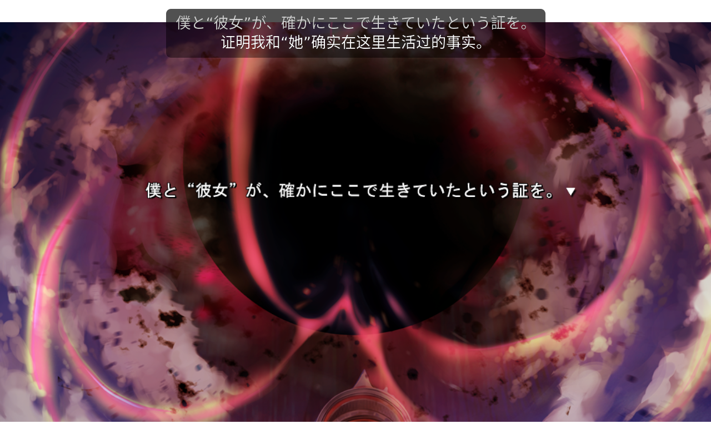

# Decky Live Caption

Steam Deck 游戏模式下的自动 OCR 与翻译字幕插件。自动读取指定区域的文字，在独立字幕条显示原文和译文。
无需逐句长按，不使用截图覆盖游戏，也不暂停游戏。



运行画面：《終わる世界とバースデイ》（コットンソフト）。游戏画面及文字版权归原权利人所有，不属于本项目 GPL 许可范围。

## 功能

- 自动区域 OCR、文字稳定等待和重复对白缓存。
- Hy-MT2 本机离线翻译，不发送对白到远程服务。
- 插件内下载 Hy-MT2 模型和 llama.cpp Vulkan 运行时，显示进度并校验 SHA-256。
- 通过上下左右边界设置识别区和字幕区，支持背景透明度和字号调整。
- 修改设置后自动保存并应用，关闭侧栏不会丢失修改。
- 原文与译文使用相同字体设置及字号，可隐藏原文。
- 打开 Steam 侧边菜单时暂停对白识别。退出或切换游戏时停止会话。

当前版本为 **0.1.0-alpha.2**。OCR 可能受字体、动态背景和竖排文字影响，机器翻译也可能出错。
本插件不包含文本 Hook、每游戏配置、术语表或历史字幕面板。

## 安装

需要 SteamOS 游戏模式、Decky Loader 和 Python 3.12+。桌面模式不在支持范围内。

1. 从 Decky 开发者设置安装插件 ZIP。
2. 在插件目录，以普通用户运行 `bash scripts/setup-runtime.sh`。
3. 将脚本输出的 Python 路径填入插件面板。
4. 将 Screen AI 的 `resources` 目录填入 OCR 模型路径。

Screen AI 可以使用 Decky Translator 已下载的资源。目录必须包含 `libchromescreenai.so` 及配套模型。
本插件不下载或附带 Google 的原生库和模型，也不修改其他插件的资源。
Python 安装脚本需要网络，只创建独立虚拟环境，不安装 SteamOS 系统包。

## 下载离线翻译模型

1. 在插件的“翻译”区域点击“下载离线翻译模型与运行时”。
2. 等待下载及文件校验完成。
3. 点击“使用已下载的模型”。
4. 等待面板显示“已保存并应用”。

下载包括 Hy-MT2 1.8B Q4_K_M 和 llama.cpp b10175 Vulkan 运行时，合计约 1.17 GB。
安装需要至少 1.6 GiB 可用空间。文件保存在用户的 `~/homebrew/data/DeckyLiveCaption/` 下。
下载使用 Hugging Face 和 GitHub 官方发布地址，需要网络。下载完成后的本机推理不需要网络。

下载支持取消，不支持断点续传。下载失败时显示错误，不切换镜像或翻译服务。
文件校验失败不会覆盖已有文件。模型可以用自定义路径手动配置。

## 使用

1. 在游戏模式启动游戏，进入有文字的场景。
2. 在插件中设置识别区域，使它覆盖对话文字。
3. 将字幕条放在识别区域之外，避免识别到自己的译文。
4. 等待设置自动保存，再点击“开始自动识别”。

区域使用上下左右四条边界，以屏幕百分比表示。
左右边界从屏幕左侧计算，上下边界从屏幕顶部计算。
`0%` 对应左侧或顶部，`100%` 对应右侧或底部。调整一条边界不会移动对面的边界。
“背景不透明度”为 `0` 时背景完全透明，为 `1` 时背景完全不透明。文字保持不透明。
原文和译文共用字号，默认 18px。长文本超出字幕最大高度时会被裁切。

停止调整约 0.6 秒后，插件自动保存并应用设置，无需另点保存按钮。
正在识别时，插件会短暂重启识别，然后继续当前游戏的会话。
设置无效时，面板显示错误并保留修改。修正设置后，插件会再次自动保存。
识别区域需要随游戏布局调整，插件不会自动查找对话框。

## 翻译后端与隐私

**仅识别**只显示原文，不发送翻译请求。

**Hy-MT2**在本机运行。插件启动会话时加载模型，停止会话时关闭自己的推理进程。
推理服务只监听回环地址，并使用临时认证密钥。GPU 推理会与游戏共享硬件资源。
可以减少 GPU 层数或设为 `0` 使用 CPU，但这会影响速度。

插件不收集遥测，不将捕获图像或对白写入文件。配置会保存在 Decky 的插件设置目录。
本项目不包含用户配置、连接信息、游戏文件、存档或模型权重。

## Credits

- **Tencent Hy / Hunyuan 团队**：[Hy-MT2 1.8B GGUF](https://huggingface.co/tencent/Hy-MT2-1.8B-GGUF)，离线翻译模型，Apache-2.0。
- **Google / Chromium**：[Screen AI](https://source.chromium.org/chromium/chromium/src/+/main:services/screen_ai/)，本机 OCR。原生资源遵循各自分发条款。
- **ggml-org 与贡献者**：[llama.cpp](https://github.com/ggml-org/llama.cpp)，本机模型推理，MIT。
- **cat-in-a-box 与贡献者**：[Decky Translator](https://github.com/cat-in-a-box/Decky-Translator)，Screen AI 适配代码，GPL-3.0。
- **neatsorg 与贡献者**：[LiveTranslator-kun](https://github.com/neatsorg/livetranslate-decky)，被动字幕合成适配，GPL-3.0。

固定版本、文件来源及其他依赖见 [第三方声明](THIRD_PARTY_NOTICES.md)。
本项目与 Valve、Google、Tencent 或上述项目没有官方隶属关系。

## 开发与构建

需要 Node.js 22+、pnpm 10.34.5、Python 3.12+ 和 uv。

```sh
pnpm install --frozen-lockfile --ignore-scripts
uv sync --locked --group dev
pnpm typecheck
pnpm test
uv run ruff check .
uv run pytest -q
pnpm build
uv run python scripts/package.py
```

打包前将源文件加入 Git 暂存区。脚本从受跟踪文件生成源码包。
`artifacts/` 下的安装 ZIP 和对应源码 ZIP 需一起分发。构建流程不会自动发布版本或部署插件。

## 许可证

本项目代码采用 GPL-3.0-only。第三方代码、模型和展示截图保留各自权利及许可条件。
